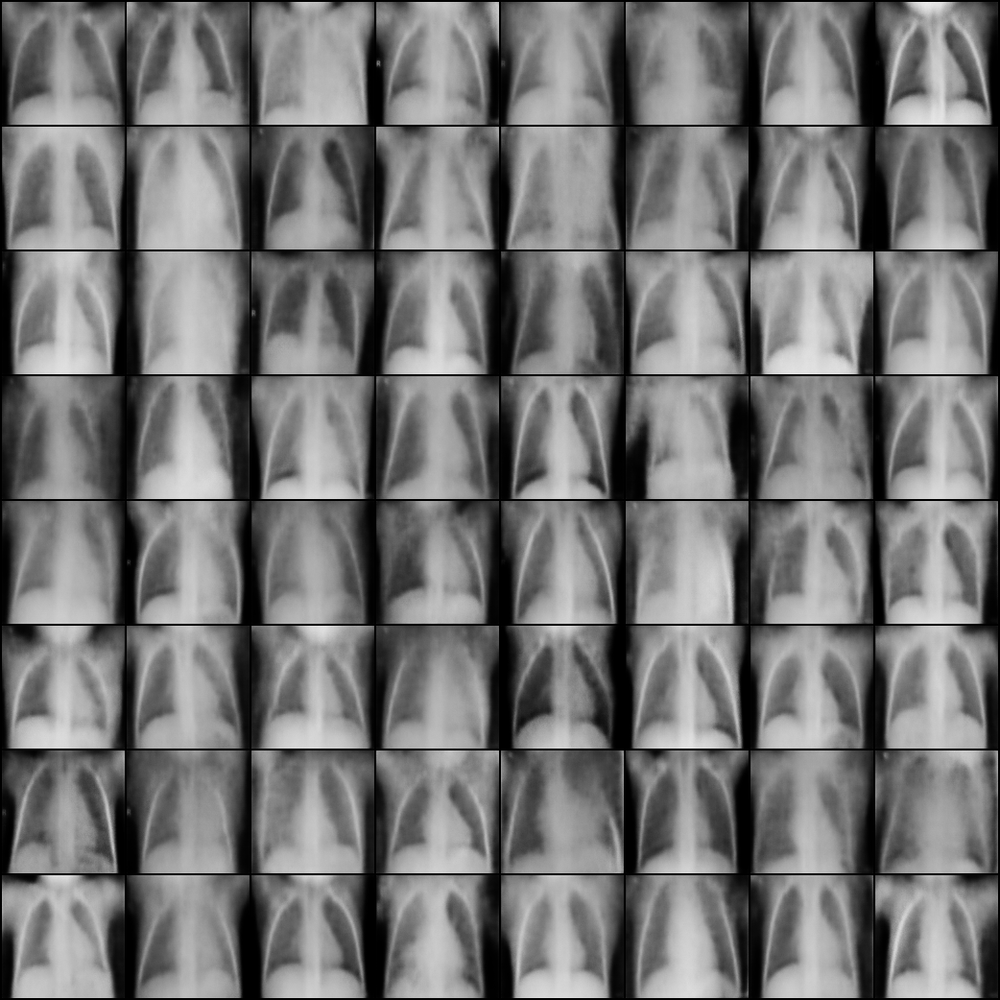
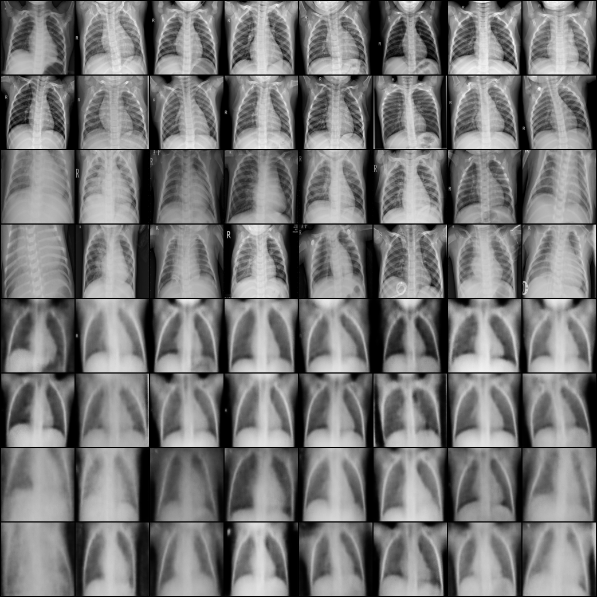

# Homework 1: Generating Chest X-rays with a VAE

For this homework I implemented a convolutional variational autoencoder (VAE) in PyTorch, trained it on the Kaggle pediatric chest X-ray dataset, generated new 128×128 radiographs by sampling from the prior, and scored those samples with FID and Inception Score. The write-up is in [report/report.tex](report/report.tex) (NeurIPS 2025 template).

## What the homework covers

1. **Model.** A convolutional VAE with a diagonal Gaussian posterior over a 128-d latent and a Bernoulli decoder, trained on the negative ELBO (BCE summed over pixels + β·KL, β = 1) with the reparameterization trick.
2. **Data.** The [chest X-ray pneumonia dataset](https://www.kaggle.com/datasets/paultimothymooney/chest-xray-pneumonia): 5,216 training and 624 test images, NORMAL and PNEUMONIA. The VAE ignores the labels.
3. **Training.** The model is selected on a validation split, with training curves and sample and reconstruction grids saved along the way.
4. **Generation.** New images come from decoding z ~ N(0, I).
5. **Evaluation.** FID and Inception Score are computed with PyTorch-Ignite exactly as in its [GAN evaluation blog post](https://pytorch-ignite.ai/blog/gan-evaluation-with-fid-and-is/): images are resized to 299×299 with PIL bilinear, left in [0, 1], and both metrics use ignite's default extractor, Inception-v3's 1000-way softmax. They are reported next to real-vs-real baselines.

## Model

- **Encoder.** Five stride-2 4×4 convolutions (32 → 64 → 128 → 256 → 512 channels, each followed by BatchNorm and LeakyReLU(0.2)) take the image down to 4×4. Two linear heads then give μ and log σ².
- **Decoder.** It mirrors the encoder with transposed convolutions and outputs per-pixel logits. A sigmoid turns them into pixel values.
- **Size.** 8.73M parameters in total.
- **Stability.** log σ² is clamped to [-10, 10], so exp(log σ²) can't blow up the KL term.
- **Decoder likelihood.** `--likelihood bernoulli` (the default) uses BCE summed over pixels. `--likelihood gaussian` is the σ-VAE of Rybkin et al. (2021): the reconstruction term is the negative log-likelihood of the image under N(sigmoid(logits), σ²), with one σ shared by all pixels and set to its maximum-likelihood value sqrt(MSE) on each batch (floored at e⁻⁶). This weights reconstruction against KL automatically, rather than through β. The Gaussian NLL is a density, so it and the total loss can go below zero, and it is not comparable to the BCE numbers.
- **KL warm-up.** `--kl_warmup N` ramps the training KL weight linearly over the first N epochs, from β/N in epoch 1 to β in epoch N. It works with either likelihood. Validation and test losses always use the full β.

## Data preparation

- **Validation split.** The official validation split has only 16 images, so [dataset.py](dataset.py) holds out a class-stratified 10% of the training split instead (4,694 train / 522 validation). The test split is used only for the final evaluation.
- **Preprocessing.** Images are converted to grayscale and resized straight to 128×128. The X-rays are not square (width/height from about 1 to 1.9), so this squashes the wider ones horizontally, but nothing is cut off or padded. We also tried the alternatives: a center crop cuts off up to about half of the widest images, and padding with black to a square left streaky artifacts along the black bands in the samples. [check_aspect.py](check_aspect.py) prints aspect-ratio statistics and saves a squashed-vs-cropped comparison to [outputs/aspect_check.png](outputs/aspect_check.png).

## Setup

```bash
pip install -r requirements.txt
```

Download the dataset into `data/`, which is git-ignored. This needs a [Kaggle API token](https://www.kaggle.com/docs/api):

```bash
kaggle datasets download -d paultimothymooney/chest-xray-pneumonia -p data --unzip
```

The scripts expect this layout:

```
data/chest_xray/
├── train/{NORMAL,PNEUMONIA}/*.jpeg
├── val/{NORMAL,PNEUMONIA}/*.jpeg
└── test/{NORMAL,PNEUMONIA}/*.jpeg
```

## Usage

Run every command from this folder (`HW1_VAE/`).

| Command | What it does |
| --- | --- |
| `python run_all.py` | Trains the model, then runs FID/IS on the best checkpoint. It takes the same arguments as `train.py`. |
| `python train.py --out_dir outputs/run3` | Trains only. Writes `config.json`, `history.csv`, `loss_curve.png`, `train.log`, sample grids every 10 epochs, `model.pt`, `best.pt` and `test_metrics.json`. |
| `python fid_is.py --ckpt outputs/run2/best.pt` | Computes FID and IS over 5 sampling seeds. Writes `fid_is_best.json` and `generated_best.png` next to the checkpoint. |
| `python check_aspect.py` | Prints aspect-ratio statistics for the dataset and saves the squash-vs-crop comparison image. |

Run `python train.py --help` to see every hyperparameter.

## Final settings (run 2)

| Setting | Value |
| --- | --- |
| Image size | 128 × 128, grayscale |
| Latent dimension | 128 |
| Optimizer | Adam, lr 3e-4, cosine annealing to 0 |
| Batch size / epochs | 64 / 100 |
| Loss | BCE (sum) + β·KL, β = 1 |
| Gradient-norm clip | 100 |

## Results

**Run 1** used lr 1e-3 with no safeguards and diverged at epochs 22–23: the training KL jumped from 58 to 1.4×10⁵ nats and never recovered. **Run 2** lowered the learning rate and added cosine decay, the log-variance clamp and gradient clipping. It then trained stably for 100 epochs. The best validation loss came at epoch 93.

| Metric (run 2, epoch 93) | VAE | Real-image baseline |
| --- | --- | --- |
| Test negative ELBO per image (nats) | 9,429.9 (recon 9,373.1 + KL 56.8) | n/a |
| FID vs. train, N = 5,216 ↓ | 247.5 ± 0.4 | n/a |
| FID vs. train, N = 624 ↓ | 261.6 ± 2.0 | 26.7 ± 0.5 (test vs. train) |
| Inception Score ↑ | 1.77 ± 0.01 | 2.28 (test), 2.27 (train) |

FID and IS are the mean ± std over 5 sampling seeds. The generated images get the overall chest anatomy right but are blurry, as is typical for a VAE with a pixel-wise likelihood. That blur explains most of the gap to the real baseline. These run 2 scores come from an earlier version of `fid_is.py` (2048-d pool features, ImageNet-normalized input), so they can't be compared with scores from the current script.

<p align="center">
  
  
</p>

*Left: 64 images generated from z ~ N(0, I). Right: validation images (rows 1–4) and their reconstructions (rows 5–8) after epoch 100.*

## Files

```
HW1_VAE/
├── model.py         VAE and the negative-ELBO loss
├── dataset.py       transforms, stratified train/val split, data loaders
├── train.py         training loop, checkpoints, curves, sample grids, test loss
├── fid_is.py        FID / Inception Score with real-vs-real baselines
├── run_all.py       train.py followed by fid_is.py on best.pt
├── check_aspect.py  aspect-ratio check: squash vs. center crop
├── outputs/
│   ├── run1/        diverged first run (lr 1e-3)
│   ├── run2/        final run: logs, curves, samples, test and FID/IS metrics
│   └── aspect_check.png
└── report/          LaTeX report and figures
```

Checkpoints (`*.pt`) and the dataset are git-ignored.
